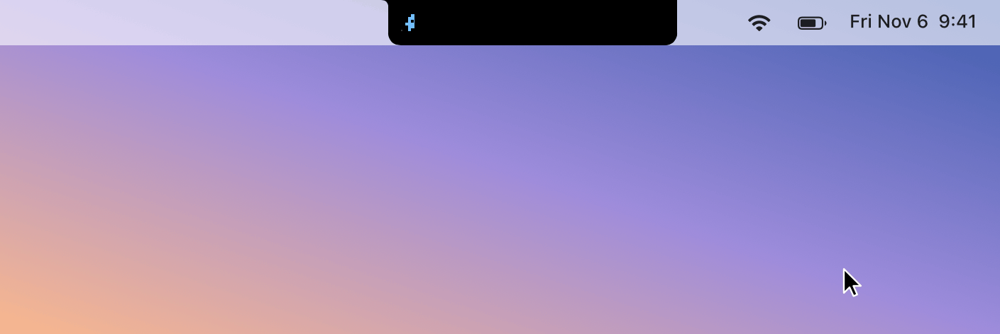
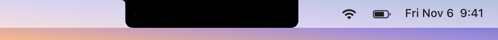

# t3-notch

Your [T3 Code](https://github.com/ytkimirti/t3code) agents, living in the MacBook notch.

<p align="center">
  
</p>

A black wing grows out of the notch's left edge with one figure per agent:

- **Blue** while it works (subagents count too).
- **Grey** while it waits on another thread or on background work.
- **Orange** once it woke from a snooze and you haven't looked yet.
- **Green** once it finished and you haven't looked yet.
- **Dim green** once it's finished and you've seen it, until you settle it or write again.

The wing can grow all the way to the screen's left edge, over the app menus. When more agents
run than fit, every group with agents keeps at least one figure, and a group with more than it
shows adds a `+N` for the rest.

Hover the notch to list the woken, finished, and read threads (red: failed, amber: hit a usage
limit), and click one to open it in T3 Code. Nothing to show means no wing: the notch looks like
a notch. Need the menus under the wing? **Hide for a minute** at the bottom of the list takes it
away for 60 seconds; it comes back once the pointer isn't where the wing would be.

## Styles

`critters` (the default): pixel creatures that blink now and then. They trot and kick up dust while
working, glance around and tap their feet while waiting, nudge with a "!" when just woken, sleep
under floating z's when done, and doze dimly once read.

`equalizer`: bars that bounce while working, idle at half height while waiting or just woken,
and rest short when done, dim once read.

<p align="center">
  
</p>

## Requirements

- An Apple silicon Mac on macOS 14 or later, with the Xcode command line tools (`xcode-select --install`).
- One or more T3 Code servers the Mac can reach. Plain HTTP works for Tailscale (`*.ts.net`) names, IP
  addresses, and local hosts (`.local`); other domains need HTTPS.

External display, or no notch? With an external display connected, the wing shows only there
(the main display if it's external), as a pill at the top center of its menu bar, no wider than
its figures.
A long pill grows left, all the way to the screen's edge if it needs to.
It hides over full-screen apps and an auto-hidden menu bar.

## Install

On each machine running a T3 server, issue a read-only token:

```sh
t3 auth session issue --scope orchestration:read --ttl 3650d --label "notch" --token-only
```

The T3 Code desktop app runs its own server on the Mac (`127.0.0.1:3773`), and its CLI lives at
`~/.t3/bin/t3`.

On the Mac, write `~/.config/t3-notch/config.json` and keep it private (`chmod 600`):

```json
{
  "servers": [
    { "url": "http://127.0.0.1:3773", "token": "<token from the Mac>" },
    { "url": "http://my-server.my-tailnet.ts.net:3773", "token": "<token from the server>" }
  ],
  "style": "critters"
}
```

Agents from every server count together. With one server, top-level `"url"` and `"token"` work
too. If a server drops, its agents keep counting for 30 seconds in case it comes right back.
`style` is optional. Use the full hostname: URLSession upgrades a bare `http://dev` to HTTPS
because `.dev` is HSTS-preloaded.

Then build, install to `~/Applications`, and run it as a LaunchAgent that starts at login:

```sh
git clone https://github.com/ytkimirti/t3-notch && cd t3-notch
./install.sh
```

Logs go to `~/Library/Logs/t3notch.log`. After editing the config, restart it:

```sh
launchctl kickstart -k gui/$(id -u)/com.kimirti.t3notch
```

To uninstall:

```sh
launchctl bootout gui/$(id -u)/com.kimirti.t3notch
rm -rf ~/Library/LaunchAgents/com.kimirti.t3notch.plist ~/Applications/t3notch.app
```

## What counts as what

The counts follow T3's default sidebar:

- **Finished**: a top-level thread showing "done" (its run ended after you last opened it), or
  one that failed since you last opened it. Settled, snoozed, archived, waiting, and approval- or
  input-blocked threads are left out.
- **Woke**: the sidebar's "Woke" badge: a snooze ended after you last opened the thread, and it
  isn't settled. Only where the badge shows: a woken thread at work counts as working, and one
  that failed stays a failure.
- **Read**: any other top-level thread whose run finished or failed, still in the sidebar's
  active list (not pinned, settled, snoozed, or archived). Usually one you've already opened.
  Read figures get only the room the other groups leave.
- **Working**: the sidebar's working rule, plus subagents, since each is an agent at work.
- **Waiting**: the sidebar's "Waiting": blocked on another thread (such as a parent waiting on
  its subagents) or parked on background work it awaits. Top-level only, minus settled and
  snoozed threads.

A subagent's approval or input request rolls up to its parents, as in the sidebar, so those
threads count as neither working nor waiting.

## How it works

One WebSocket to the server's `/ws`, subscribed to `orchestration.subscribeShell` (Effect RPC,
JSON). The server sends a snapshot, then a `thread.updated` per change, so nothing polls. The
client acks each chunk, pings every 20 s, and reconnects with backoff and on wake.

The wing animations run in Core Animation, so the app does no per-frame work.

## Development

```sh
./test.sh    # status rules and wing layout
./build.sh   # build/t3notch.app
```

`build/t3notch.app/Contents/MacOS/t3notch --render <dir>` connects with your config, prints the
counts, and writes `collapsed.png`, `expanded.png`, and wing strips for each style without
opening a window.

`--demo <dir>` needs no server: it plays a scripted set of made-up agents through the real wing
layers and writes the frames. The GIFs above come from (needs `ffmpeg`):

```sh
build/t3notch.app/Contents/MacOS/t3notch --demo build/demo
for s in critters equalizer; do
  ffmpeg -framerate 25 -i build/demo/$s/frame-%04d.png \
    -vf "split[a][b];[a]palettegen[p];[b][p]paletteuse=dither=none:diff_mode=rectangle" -loop 0 docs/$s.gif
done
```

## Credits

The notch window, shape, and hover handling follow [CodeIsland](https://github.com/wxtsky/CodeIsland)
(MIT).

## License

[MIT](LICENSE)
